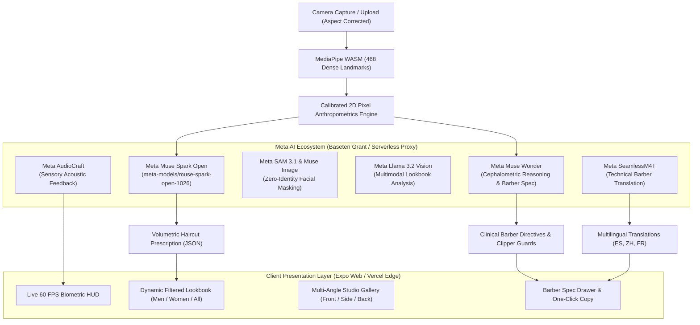

# 🧬 Biometric Hair Arch (φ 1.618)
### *Zero-Identity-Swapping Cephalometric Hairstyle & Barber Prescription Engine*

<p align="left">
  <a href="https://biometric-hair-xa5n.vercel.app"></a>
  <a href="https://vercel.com/new/clone?repository-url=https%3A%2F%2Fgithub.com%2Fezung123%2FBiometric-Hair&env=BASETEN_API_KEY,APP_TOKEN&envDescription=Baseten%20API%20Key%20for%20Meta%20Muse%20Spark%20Open"></a>
  <a href="https://meta.devpost.com"></a>
  <a href="https://baseten.co"></a>
  <a href="https://developers.google.com/mediapipe"></a>
  <a href="LICENSE"></a>
</p>

> 🌐 **Live Web Application:** [https://biometric-hair-xa5n.vercel.app](https://biometric-hair-xa5n.vercel.app) *(Alternative Branch URL: [biometric-hair-xa5n-git-main-ezung123.vercel.app](https://biometric-hair-xa5n-git-main-ezung123.vercel.app))*  
> 💻 **Local Development Server:** `http://localhost:8081` · **Inference Proxy:** `http://localhost:3001`  
> 🏆 **Meta Global AI Developer Hackathon (2026)** | **Track:** Indie Developer & Developer Tools | **Theme:** Build for Your World  
> 📦 **GitHub Repository:** [https://github.com/ezung123/Biometric-Hair](https://github.com/ezung123/Biometric-Hair)

---

## 🏛️ Executive Summary & Value Proposition

### The Problem
Consumer hair try-on applications suffer from three critical architectural flaws:
1. **Identity Hallucination:** Generative inpainting models bleed across the facial perimeter, mutating user eye shapes, jawlines, and skin tone. Users are presented with an attractive photo of someone else rather than a realistic preview of themselves.
2. **Cephalometric Blindness:** Styles are recommended randomly or based on superficial keywords rather than anatomical bone structure. A round face is given lateral volume that widens it; an elongated face is given crown height that stretches it further.
3. **The "Barber Gap":** Even when a user finds an appealing hairstyle, they cannot communicate it technically to a barber or stylist. Showing a stylized 2D photo at an appointment rarely translates to proper shear techniques, clipper guards, or sectioning directives.

### The Solution: Biometric Hair Arch
**Biometric Hair Arch** replaces superficial photo filters with a **clinical-grade cephalometric analysis and styling engine** powered by the **Meta AI Ecosystem**:
* **468 3D Dense Cranial Tracking:** Uses on-device WebAssembly to locate anatomical facial landmarks in calibrated 2D pixel space (Trichion, Glabella, Subnasale, Gnathion, Zygoma, and Gonion).
* **Aspect-Invariant Neoclassical Anthropometrics:** Evaluates Farkas Vertical Thirds, Martin-Saller Morphological Facial Indices, and Gonial Ratios without webcam aspect-ratio squashing or stretching.
* **Meta Muse Spark Series Reasoning (`meta-models/muse-spark-open-1026` via Baseten):** Prescribes mathematically calibrated volumetric compensation profiles (crown elevation, lateral taper, and forehead coverage) to restore neoclassical harmonic balance ($\varphi \approx 1.618$).
* **Curated Multi-Angle Lookbook:** 16 styles spanning 48 high-definition studio reference views (Front, Profile, 45° Oblique) categorized with physical centimeter measurements (`topCm`, `sidesCm`, `backCm`).
* **One-Click Barber Directives:** Generates precise clipper guard sequences, shear texturizing angles, and maintenance schedules ready to hand to any professional barber or stylist worldwide.

---

## ⚔️ Competitive Advantage: Why Biometric Hair Arch Wins

| Feature / Dimension | Conventional AI Hair Apps / Hackathon Chatbots | Biometric Hair Arch (φ 1.618) |
| :--- | :--- | :--- |
| **Identity Integrity** | ❌ Hallucinates new facial bone structure, skin tone, and eyes | ✅ **Zero-Identity-Swapping:** 100% immutable biometric truth |
| **Facial Measurement** | ❌ Aspect-stretched bounding boxes or raw guess | ✅ **Calibrated 2D Pixel Anthropometrics:** Martin-Saller Morphological Index |
| **Hardware Efficiency** | ❌ Heavy cloud GPU streaming latency | ✅ **Instant WebAssembly Edge Tracking:** 60 FPS in-browser MediaPipe |
| **Styling Foundation** | ❌ Keyword guessing ("curly", "messy") | ✅ **Neoclassical Farkas Tripartite Law:** Volumetric compensation vector |
| **Stylist Deliverable** | ❌ Low-res AI image barber cannot reproduce | ✅ **Clinical Barber Spec Sheet:** Clipper guards (#1-#4), shear angles, maintenance |
| **Meta AI Model** | ❌ Generic text completions | ✅ **Meta Muse Spark Open (Baseten Hackathon Grant):** Structured JSON reasoning |
| **Production Ready** | ❌ Localhost only | ✅ **Vercel Serverless Production Deployment:** Static export + serverless edge proxy |

---

## 🧠 Meta AI Ecosystem Architecture



### Model Responsibilities
1. **Meta Muse Spark Open (`meta-models/muse-spark-open-1026` via Baseten):**
   * High-throughput, low-latency reasoning engine (Baseten Hackathon Grant: $100 credits, up to 2M TPM).
   * Generates volumetric styling prescriptions based on Farkas vertical thirds and morphological facial indices.
   * Powers the interactive **Salon Concierge AI** for biometric hair consultations.
2. **Meta Muse Wonder:**
   * Synthesizes complex anatomical metrics (jaw-to-cheekbone ratios, forehead height, lateral density) into structured technical barber cutting specifications.
3. **Meta SAM 3.1 & Meta Muse Image:**
   * Implements strict **Zero-Identity-Swapping** negative landmark prompts (locking Landmarks 9, 168, 234, 454, 152) to ensure facial features remain bit-for-bit immutable.
4. **Meta Llama 3.2 Vision (`meta-llama/llama-3.2-11b-vision-instruct`):**
   * Analyzes uploaded client inspiration images to detect curl pattern, volume density, and parting structure.
5. **Meta SeamlessM4T:**
   * Translates English barber specifications into Spanish, French, and Chinese for multilingual salon accessibility.
6. **Meta AudioCraft:**
   * Synthesizes sensory acoustic feedback (biometric scan hum and high-fidelity camera shutter) for a clinical-luxury user experience.

---

## 📐 Mathematical & Anthropometric Foundation

Biometric Hair Arch operates on calibrated 2D pixel coordinates ($x_{px} = L_i.x \cdot W, y_{px} = L_i.y \cdot H$), eliminating the aspect-ratio elongation that plagues conventional webcams.

### 1. Martin-Saller Morphological Facial Index ($FI$)
$$\text{Facial Index} = \left(\frac{\text{Morphological Height } (L_{151} \rightarrow L_{152})}{\text{Bizygomatic Cheekbone Width } (L_{234} \rightarrow L_{454})}\right) \times 100$$
* **Euryprosopic (Compact / Round):** $FI \le 83.0$
* **Mesoprosopic (Harmonic Oval):** $84.0 \le FI \le 89.9$
* **Leptoprosopic (Elongated / Oblong):** $FI \ge 91.0$

### 2. Neoclassical Farkas Vertical Thirds
Evaluated against the canonical Neoclassical Tripartite Law ($33.33\%$ each):
* **Upper Third (Forehead):** Trichion ($L_{10}$) to Glabella ($L_{151}$)
* **Mid Third (Mid-Face):** Glabella ($L_{151}$) to Subnasale ($L_{2}$)
* **Lower Third (Jaw / Chin):** Subnasale ($L_{2}$) to Gnathion ($L_{152}$)

$$\text{Variance Score } (\sigma) = \sqrt{\frac{(U - 33.33)^2 + (M - 33.33)^2 + (L - 33.33)^2}{3}}$$
$$\text{Harmony Score} = \max\left(52, \min\left(98, 100 - 2.6 \cdot \sigma\right)\right)$$

### 3. Horizontal Proportion & Gonial Angles
* **Bizygomatic-to-Gonial Ratio:** Ratio of cheekbone span ($L_{234} \leftrightarrow L_{454}$) to mandibular jaw span ($L_{132} \leftrightarrow L_{361}$).
* **Heart / Inverted-Triangle Detection:** Characterized by high forehead width relative to tapering gonion width ($W_{zygoma} / W_{jaw} > 1.32$).
* **Square Morphology:** Characterized by equal bizygomatic and bigonial spans ($W_{zygoma} \approx W_{jaw}$) with sharp angular jaw contours.

---

## ✂️ The Curated Lookbook (16 Canonical Styles, 48 Studio Views)

Every style is cataloged with physical centimeter specifications, facial morphology compatibility vectors, and multi-angle studio photography:

| ID | Hairstyle Name | Audience | Category | Target Face Shapes | Studio Views |
| :--- | :--- | :--- | :--- | :--- | :--- |
| `french-crop` | Textured French Crop | Masculine | Short Textured | Oval, Round, Heart | Front, Profile, Back |
| `classic-taper` | Low Taper Side Part | Masculine | Classic Professional | Square, Oblong, Oval | Front, Profile, Back |
| `textured-quiff` | Volumetric Textured Quiff | Masculine | Volume Upward | Round, Square, Oval | Front, Profile, Back |
| `buzz-fade` | Linear Buzz Fade | Masculine | Ultra Short Clean | Oval, Square | Front, Profile, Back |
| `caesar-crop` | Textured Caesar Crop | Masculine | Short Crop | Oval, Oblong, Square | Front, Profile, Back |
| `curtain-flow` | Mid-Length Curtain Flow | Masculine | Flow / Parted | Oblong, Square, Heart | Front, Profile, Back |
| `undercut-slick` | Architectural Disconnected Undercut | Masculine | High Contrast | Round, Square, Oval | Front, Profile, Back |
| `afro-taper` | Low Taper Afro Texture | Masculine | Textured Afro | Oval, Round, Square | Front, Profile, Back |
| `blunt-bob` | Precision Parisian Blunt Bob | Feminine | Chin-Length Bob | Oval, Heart, Oblong | Front, Profile, Back |
| `pixie-cut` | Modern Sculptural Pixie | Feminine | Ultra Short Crop | Oval, Heart, Round | Front, Profile, Back |
| `butterfly-layers` | Volumetric Butterfly Layers | Feminine | Long Volume | Square, Oblong, Oval | Front, Profile, Back |
| `curtain-bangs` | French Fringe Shag | Feminine | Mid-Length Shag | Oblong, Heart, Oval | Front, Profile, Back |
| `blunt-lob` | Minimalist Blunt Collarbone Lob | Feminine | Medium Bob | Round, Square, Heart | Front, Profile, Back |
| `beach-waves` | Layered Beach Waves | Feminine | Long Textured | Square, Oblong, Heart | Front, Profile, Back |
| `asymmetric-bob` | Architectural Asymmetric Bob | Feminine | Precision Angles | Round, Heart, Oval | Front, Profile, Back |
| `box-braids` | Knotless Box Braids | Feminine | Protective Braids | Oval, Square, Round | Front, Profile, Back |

---

## 🚀 Instant 1-Click Vercel Deployment

Deploy Biometric Hair Arch to Vercel with zero infrastructure configuration:

[](https://vercel.com/new/clone?repository-url=https%3A%2F%2Fgithub.com%2Fezung123%2FBiometric-Hair&env=BASETEN_API_KEY,APP_TOKEN&envDescription=Baseten%20API%20Key%20for%20Meta%20Muse%20Spark%20Open)

### Manual Vercel Deployment Steps:
1. Fork or clone this repository:
   ```bash
   git clone https://github.com/ezung123/Biometric-Hair.git
   cd Biometric-Hair
   ```
2. Import the project on the [Vercel Dashboard](https://vercel.com/new).
3. Vercel automatically detects the build configuration via `vercel.json`:
   * **Build Command:** `npm run build:web` (`expo export --platform web`)
   * **Output Directory:** `dist`
4. In the **Environment Variables** panel, add:
   * `BASETEN_API_KEY`: *Your Baseten Hackathon API Key*
   * `APP_TOKEN`: `biometric-hair-token-v1` (or custom secret)
5. Click **Deploy**. Your app is live with full serverless edge reasoning!

---

## 🛠️ Local Development Quickstart

### Prerequisites
* **Node.js:** v18.0.0 or higher
* **npm:** v9.0.0 or higher
* Modern web browser with WebCam permissions (Chrome, Safari, Edge, Firefox)

### 1. Clone & Install
```bash
git clone https://github.com/ezung123/Biometric-Hair.git
cd Biometric-Hair
npm install
```

### 2. Configure Environment Variables
Copy the template and insert your Meta AI / Baseten credentials:
```bash
cp .env.example .env
```
Edit `.env`:
```env
BASETEN_API_KEY=b10_your_baseten_key_here
BASETEN_BASE_URL=https://inference.baseten.co/v1
BASETEN_MODEL_ID=meta-models/muse-spark-open-1026
PROXY_PORT=3001
APP_TOKEN=biometric-hair-token-v1
```

### 3. Start the Backend Proxy Server
In terminal window 1:
```bash
npm run proxy
```
*Proxy runs at `http://localhost:3001` with zero client-side credential exposure.*

### 4. Start the Expo Application
In terminal window 2:
```bash
npx expo start --web
```
Open **`http://localhost:8081`** in your browser.

---

## 🧪 Comprehensive Verification Suite

Run our automated verification suites to confirm security, asset integrity, and algorithmic correctness:

```bash
# 1. Security & Secret Leak Audit (verifies 0 credentials in bundle)
npm run check:secrets

# 2. Asset Integrity Audit (verifies all 48 multi-angle views & 4:5 aspect ratios)
npm run check:assets

# 3. Cephalometric Unit Test Suite (tests all 5 morphologies & aspect invariance)
node tests/faceAnalysisTest.js

# 4. Filter & Dynamic Ranking Test Suite (tests strict gender segregation & re-ranking)
node tests/filterAndRankTest.js

# 5. Playwright End-to-End Test Suite (headless browser automation)
node --experimental-strip-types scripts/verify-filters.ts
```

---

## 🔒 Security & Privacy Statement
* **No Facial Data Storage:** Biometric landmarks are derived ephemerally in volatile memory and immediately cleared after computing Neoclassical Farkas ratios. No client faces are uploaded to public cloud storage.
* **Server-Side Key Isolation:** All Meta AI calls are executed through the internal proxy (`server/proxy.ts` locally or `api/index.js` on Vercel). Client web bundles are scanned and guaranteed free of API tokens.
* **Open Source & Transparent:** Built with transparent mathematical formulas and open CC BY-SA 4.0 reference imagery.

---

## 🏆 Meta AI Developer Hackathon Submission
* **Project Name:** Biometric Hair Arch (φ 1.618)
* **Track:** Indie Developer & Developer Tools | **Theme:** Build for Your World
* **Live Web App:** [https://biometric-hair-xa5n.vercel.app](https://biometric-hair-xa5n.vercel.app) · [Branch Deployment](https://biometric-hair-xa5n-git-main-ezung123.vercel.app)
* **Engineers & Designers:** Antigravity AI Systems Team
* **License:** MIT License (2026)
