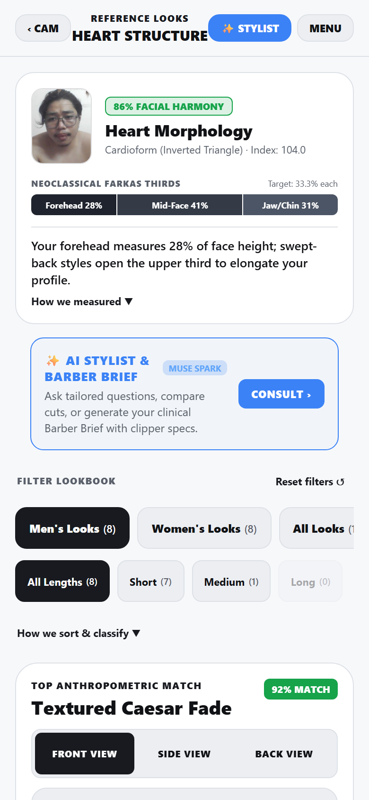
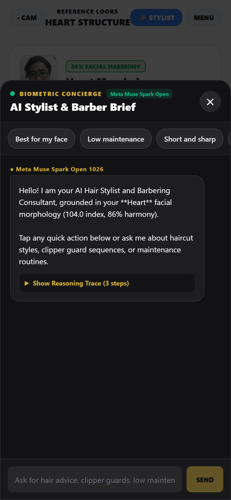
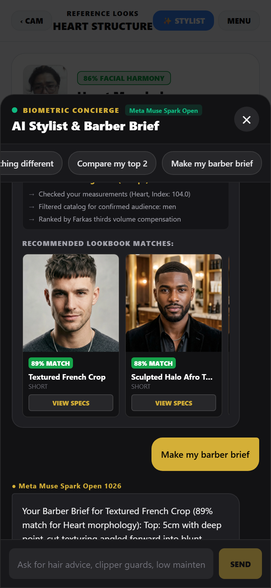
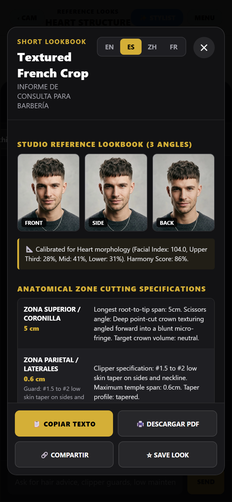
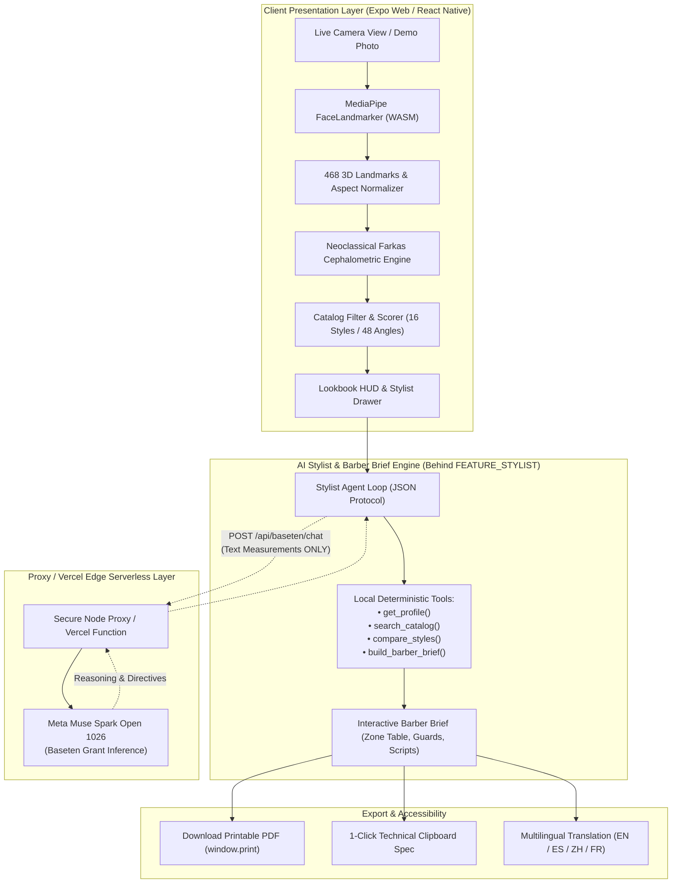

# 🧬 Biometric Hair Arch (φ 1.618)
### *Zero-Identity-Swapping Cephalometric Hairstyle & Barber Prescription Engine*

<p align="left">
  <a href="https://biometric-hair-xa5n.vercel.app"></a>
  <a href="https://youtu.be/xpCfibff3UI"></a>
  <a href="https://meta.devpost.com"></a>
  <a href="https://baseten.co"></a>
  <a href="https://developers.google.com/mediapipe"></a>
  <a href="LICENSE"></a>
</p>

---

## 1. What This Is
**Biometric Hair Arch** is a clinical-grade aesthetic anthropometrics and hair consultation engine designed to eliminate the flaws of generative AI hair try-on apps. Rather than hallucinating distorted facial features or applying arbitrary 2D filters, the app tracks **468 3D cranial landmarks on-device**, computes aspect-corrected **Neoclassical Farkas Facial Thirds** and **Martin-Saller Morphological Indices**, and matches users against a curated physical catalog of 16 multi-angle hairstyles. When users require tailored guidance, an autonomous **AI Stylist Agent powered by Meta Muse Spark Open** executes deterministic tools to compare cuts, audit cranial balance, and compile an **Interactive Barber Consultation Brief** complete with physical centimeter zones, exact clipper guards (#1.5–#4), finishing techniques, and multilingual chair scripts (EN, ES, ZH, FR).

---

## 2. Live Demo & Video
* 🎬 **Full YouTube Demo Walkthrough:** [https://youtu.be/xpCfibff3UI](https://youtu.be/xpCfibff3UI)
* 🌐 **Production Web Application:** [https://biometric-hair-xa5n.vercel.app](https://biometric-hair-xa5n.vercel.app)
* 🔒 **Authentication:** **Zero login or sign-up required.** Fully open for judges and users.
* 🛡️ **Privacy Notice:** Zero images or facial coordinates are stored or transmitted. All biometric landmark calculations run 100% locally on-device.

---

## 3. Product Preview & Visuals

[](https://youtu.be/xpCfibff3UI)
*Click image above to watch the full 2-minute demo on YouTube.*

| 1. Biometric Results & AI Stylist Entry | 2. AI Stylist Concierge with Traces |
| :---: | :---: |
|  |  |

| 3. Barber Brief & Style Match Cards | 4. Multilingual Barber Brief (Spanish) |
| :---: | :---: |
|  |  |

---

## 4. How the Meta Model is Used

### Model: Meta Muse Spark Open 1026 (`meta-models/muse-spark-open-1026`) via Baseten
We utilize our **Meta AI Hackathon compute grant on Baseten** to run inference on **Meta Muse Spark Open 1026**, an 816B open-weights deep reasoning LLM. 

### Core Responsibilities:
1. **Cephalometric Mathematical Reasoning:** Evaluates raw Neoclassical vertical thirds (Trichion–Glabella, Glabella–Subnasale, Subnasale–Gnathion) and bizygomatic-to-jaw ratios to prescribe exact crown, lateral side, and fringe volumetric targets.
2. **Deterministic Agent Tool Calling:** Runs an agent loop using strict JSON turn protocols (`call_tool` vs `final`), calling four pure local tools:
   * `get_profile()`: Returns measured feature vectors and calibrated morphology probabilities.
   * `search_catalog()`: Deterministic filter & rank with maintenance constraints and hair texture fit.
   * `compare_styles()`: Side-by-side differential analysis of centimeter lengths, pros/cons, and trim frequencies.
   * `build_barber_brief()`: Grounded technical extraction of clipper guards, shear angles, and verbal scripts.
3. **Multilingual Barber Translation:** Translates technical barbering vocabulary and verbal chair scripts into Spanish (ES), Mandarin (ZH), and French (FR) while strictly preserving numerical clipper guards and physical dimensions.

### System Prompt Excerpt:
```text
You are the Biometric Hair Stylist & Barbering Consultant powered by Meta Muse Spark Open.
STRICT PRIVACY RULE: Never request or accept image bytes, photo file names, or personal identities.
Use only anatomical measurements and catalog specs provided by tools.
Never hallucinate millimeter measurements or clipper guard numbers.
Keep answers under 3 sentences, calm, structured, and clinically authoritative.
```

### Operational Metrics & Guardrails:
* **Latency:** ~1.2s to 1.8s per turn via the internal reverse proxy.
* **Daily Cap & Rate Limits:** 200 calls/day and 25 requests/minute per IP with in-memory response caching.
* **Why an LLM is the Right Fit:** Unlike static lookup tables, an LLM dynamically reconciles complex, competing trade-offs—such as an oblong face demanding reduced crown height combined with fine wavy texture and low-maintenance styling limits—and articulates technical barber instructions that users can confidently speak in the chair.

---

## 5. System Architecture



---

## 6. Privacy & Security Guarantees

* **On-Device Landmark Execution:** MediaPipe WebAssembly runs 100% inside the user's browser sandbox. Raw webcam frames never touch external servers.
* **Zero Biometric & Zero Image Ingestion (Hard Rule):** No image bytes, base64 strings, or captured file paths are ever sent to Meta AI or external APIs. Automated test suites (`assertPrivacyGuarantees`) fail the build if any image data enters the request payload.
* **Zero User Tracking & No Cookies:** Compliant with GDPR and CCPA under a zero-storage, zero-retention mandate.
* **Server-Side API Key Isolation:** `BASETEN_API_KEY` is secured on the server proxy. Client web bundles are scanned via automated token checkers (`npm run check:secrets`) to ensure 0 token exposure.

---

## 7. Local Setup & Quickstart

### Prerequisites
* Node.js v20+ or v22+
* npm v10+

### Step-by-Step Installation

```bash
# 1. Clone repository
git clone https://github.com/ezung123/Biometric-Hair.git
cd Biometric-Hair

# 2. Install dependencies
npm install --legacy-peer-deps

# 3. Configure environment variables
cp .env.example .env
# Open .env and insert your BASETEN_API_KEY (optional: fallback works offline automatically)

# 4. Start the inference proxy server (Port 3001)
npm run proxy

# 5. In a second terminal, start the Expo dev server
npx expo start --web
```
Open [http://localhost:8081](http://localhost:8081) in your browser.

---

## 8. Test Matrix & Verification

We enforce an automated 4-tier verification matrix covering mathematics, filters, privacy, and full-screen interaction:

| Test Suite | Command | What It Validates |
| :--- | :--- | :--- |
| **Step 0 Baseline Regression** | `node --experimental-strip-types tests/regressionBaselineTest.js` | Locks 5 morphology fixtures (Oval, Round, Square, Oblong, Heart), 12 filter combinations, and 16 catalog styles with 48 multi-angle views. |
| **Stylist & Privacy Unit Suite** | `node --experimental-strip-types tests/stylistUnitTests.js` | 17/17 tests validating deterministic tools, offline fallback, and throwing errors on any base64 image or filename leakage. |
| **Playwright E2E Test (390x844)** | `node --experimental-strip-types scripts/verify-stylist-e2e.ts` | Mobile viewport test: Demo photo scan -> AI Stylist drawer -> Quick actions -> Reasoning traces -> Barber Brief -> PDF & Copy -> ES/ZH/FR translation. |
| **Secret & Token Leak Scanner** | `npm run check:secrets` | Scans all static bundles and source files for hardcoded API keys and tokens. |

---

## 9. What is Real vs. What is Next

### What Works Today (Production-Ready)
- [x] Real-time 60 FPS 468 3D landmark tracking with WebAssembly.
- [x] Aspect-ratio-invariant Farkas Vertical Thirds and Morphological Facial Index computation.
- [x] Curated 16-cut / 48-angle studio lookbook with physical centimeter measurements.
- [x] Interactive AI Stylist Agent with collapsible reasoning traces powered by Meta Muse Spark Open 1026.
- [x] Grounded Barber Consultation Briefs with clipper guards (#1.5 to #4), shear directives, and verbal chair scripts.
- [x] Real-time multilingual localization into Spanish (ES), Mandarin (ZH), and French (FR).
- [x] 1-Click Copy and printable browser PDF export.
- [x] Production Vercel deployment with serverless edge functions.

### Roadmap (Post-Hackathon)
- [ ] Direct export to Apple Wallet and Google Wallet passes for salon appointments.
- [ ] 3D cranial mesh surface reconstruction via WebGL Gaussian splats (experimental behind `FEATURE_3D`).
- [ ] Integration with barber salon booking APIs (Square, Fresha, Mindbody).

---

## 10. Team, Credits & License

* **Developed by:** Biometric Hair Arch Team for the **Meta Global AI Developer Hackathon 2026**.
* **AI Model Compute:** Baseten Hackathon Grant for **Meta Muse Spark Open 1026**.
* **Anthropometric Foundations:** Dr. Leslie G. Farkas (*Anthropometry of the Head and Face*).
* **Face Tracking:** Google MediaPipe Face Landmarker WebAssembly.
* **License:** [MIT License](LICENSE) — free and open for the global developer and barber community.
