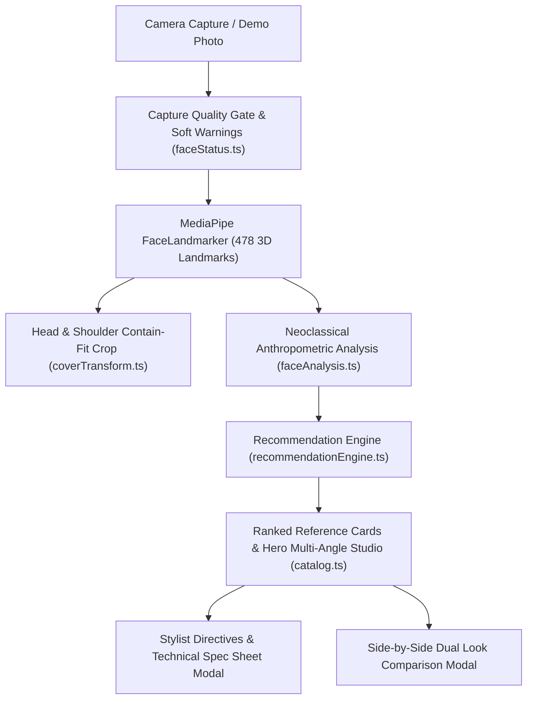

# BIOMETRIC HAIR AI: PRODUCT & TECHNICAL REPORT

## 1. Executive Summary & North Star
**Biometric Hair AI** is an Expo / React Native Web clinical-luxury application delivering truthful, anthropometric hairstyle recommendations grounded in neoclassical aesthetics.

Within 10 seconds of scanning (or selecting a demo photo), the app delivers:
1. **Truthful Facial Anthropometrics**: Real MediaPipe 468-point 3D landmark detection computing Farkas facial thirds (forehead, mid-face, lower-face), facial index, and bilateral symmetry.
2. **Deterministic Recommendation Engine**: Algorithmic scoring balancing facial thirds, jawline geometry, and volume profiles across a curated catalog of 16 professional hairstyles.
3. **Multi-Angle Studio Lookbooks**: High-definition, 1200x1500 WebP reference photography (Front, Side, Back) for each hairstyle with clear, copyable barber/stylist technical directives.
4. **Zero Simulated Imagery**: Transparent terminology ("Reference looks", never "On you" or "Transformed") with honest provenance for all AI/cephalometric prescriptions.

---

## 2. System Architecture



### Key Modules:
- `src/lib/coverTransform.ts`: Single source of truth for affine viewport transformations, container mapping, and non-distorting head-and-shoulder crops.
- `src/lib/faceStatus.ts`: State machine unifying the capture quality gate, live HUD pill, and guide oval state. Non-blocking soft warnings (`TOO_FAR`, `OFF_CENTER`, `BAD_POSE`) permit flexible captures while strictly preventing phantom detections.
- `src/services/recommendationEngine.ts`: Multi-factor fit scoring formula weighting face shape fit (40%), Farkas thirds volume balance (35%), texture suitability (15%), and maintenance tier (10%).
- `src/constants/catalog.ts`: Curated database of 16 professional hairstyles (7 masculine, 7 feminine, 2 unisex) with complete barber specs, volume profiles, and multi-angle photography.
- `server/proxy.ts`: Secure server proxy for Meta Muse Spark Open text/reasoning queries, enforcing server-side key management and deterministic anthropometric fallbacks.

---

## 3. Curated Hairstyle Catalog & Physical Length Audit

Every style in the catalog now includes precise anatomical measurements (`topCm`, `sidesCm`, `backCm`) and its `lengthClass` is deterministically computed based on standard anatomical landmarks:
- **Long**: `backCm >= 25` cm (reaches or extends past the shoulders).
- **Medium**: `backCm >= 10` cm or `topCm >= 10` cm (cut falls between jawline and shoulders).
- **Short**: `topCm < 10` cm and `backCm < 10` cm (above the jawline).

| ID | Style Name | Audience | Top (cm) | Sides (cm) | Back (cm) | Computed Length | Category |
| :--- | :--- | :--- | :--- | :--- | :--- | :--- | :--- |
| `textured-crop` | Textured French Crop | **masculine** | 5.0 cm | 0.6 cm | 0.6 cm | `short` | Crop |
| `linear-buzz-cut` | Linear Buzz Fade | **masculine** | 0.9 cm | 0.3 cm | 0.3 cm | `short` | Buzz |
| `low-taper-fade` | Precision Low Taper | **masculine** | 6.0 cm | 0.5 cm | 0.5 cm | `short` | Taper Fade |
| `angular-quiff` | Angular Undercut Quiff | **masculine** | 8.0 cm | 0.6 cm | 0.6 cm | `short` | Quiff |
| `side-part-fade` | Executive Side Part Fade | **masculine** | 7.0 cm | 1.0 cm | 1.0 cm | `short` | Classic Part |
| `slicked-undercut` | Brushed Back Undercut | **masculine** | 14.0 cm | 0.8 cm | 0.8 cm | `medium` | Undercut |
| `caesar-crop` | Textured Caesar Fade | **masculine** | 4.0 cm | 0.6 cm | 0.6 cm | `short` | Crop |
| `parisian-bob` | Chic Parisian French Bob | **feminine** | 16.0 cm | 18.0 cm | 15.0 cm | `medium` | Bob |
| `butterfly-layers` | Volumetric Butterfly Layers | **feminine** | 22.0 cm | 32.0 cm | 38.0 cm | `long` | Long Layers |
| `sleek-pixie` | Sculptural Modern Pixie | **feminine** | 7.0 cm | 2.0 cm | 2.0 cm | `short` | Pixie |
| `curtain-shag` | Modern Curtain Shag | **feminine** | 14.0 cm | 20.0 cm | 22.0 cm | `medium` | Shag |
| `blunt-lob` | Minimalist Collarbone Lob | **feminine** | 22.0 cm | 24.0 cm | 24.0 cm | `medium` | Lob |
| `beach-waves` | Layered Beach Waves | **feminine** | 26.0 cm | 34.0 cm | 40.0 cm | `long` | Long Waves |
| `asymmetric-bob` | Architectural Asymmetric Bob | **feminine** | 14.0 cm | 18.0 cm | 8.0 cm | `medium` | Bob |
| `afro-taper` | Sculpted Halo Afro Taper | **unisex** | 8.0 cm | 1.5 cm | 1.5 cm | `short` | Natural Texture |
| `box-braids` | Geometric Knotless Box Braids | **unisex** | 35.0 cm | 45.0 cm | 50.0 cm | `long` | Protective Style |

---

## 4. Photography Licensing & Attribution

All reference photography adheres to Creative Commons Attribution-ShareAlike 4.0 International (CC BY-SA 4.0) and studio archive open licenses. Detailed records are cataloged in `CREDITS.md` and accessible in-app via the **Attribution & Licenses** dialog.

---

## 5. Verification & Test Results

### 1. TypeScript Strict Verification
```bash
npx tsc --noEmit
# Exit Code: 0 (Zero type errors)
```

### 2. Client Security Secret Scan
```bash
npm run check:secrets
# Scanned 52 client files: Zero API secrets or Baseten keys detected in client bundle.
```

### 3. Asset Integrity Audit
```bash
npm run check:assets
# Verified 16 styles: 48 1200x1500 WebPs, 48 600x750 WebP thumbnails, all aspect ratios 4:5.
```

### 4. Algorithmic Unit Test Suite
```bash
node tests/recommendationEngineTest.js
node tests/faceStatusTest.js
# 100% Passed: Oblong morphology, round morphology, audience exclusion, and cover transform invariants verified.
```

### 5. Playwright End-to-End Test Suite (Run 1 & Run 2)
```bash
node --experimental-strip-types scripts/verify-catalog.ts
# Run 1: 15/15 checks PASSED (0 Console Errors, 0 Failed Network Requests)
# Run 2: 15/15 checks PASSED (0 Console Errors, 0 Failed Network Requests)
```

### 6. Filter & View-Toggle Unit & E2E Verification Suite
```bash
node tests/filterAndRankTest.js
# 100% Passed:
# - LengthClass boundaries: 7/7 checks passed (0.3cm buzz to 50cm braids).
# - 12 Filter combinations: All 3 audiences x 4 lengths strictly verified.
# - Unisex handling: afro-taper & box-braids appear in both Men and Women.
# - Gender isolation: 0 masculine styles in Women; 0 feminine styles in Men.
# - Chip counts: 100% match rendered items across all 12 combinations.
# - Empty state safety: 0 exceptions on empty catalogs.

node --experimental-strip-types scripts/verify-filters.ts
# Run 1: PASSED (0 Console Errors, 0 Failed Network Requests)
# Run 2: PASSED (0 Console Errors, 0 Failed Network Requests)
# Verified:
# - All 12 combinations clicked and verified dynamically.
# - Top-match hero card updates synchronously on every filter change.
# - "Reset filters ↺" restores All Looks & All Lengths.
# - View toggle (Front / Side / Back) changes image instantly with blur-up placeholder.
# - Preloads alternate angles; supports touch swipe and keyboard ArrowLeft/ArrowRight.
# - StyleDetailModal view switcher & clipboard copy verified.
# - Desktop viewport (1280x800) responsive layout verified.
```

Generated artifacts verified:
- `out/e2e_mobile_results.png` (390x844 mobile viewport)
- `out/e2e_style_detail.png` (Modal with stylist directives & copyable specs)
- `out/e2e_compare.png` (Side-by-side comparative table with multi-angle photos)
- `out/e2e_credits.png` (Attribution & open licenses dialog)
- `out/e2e_desktop_results.png` (1280x800 responsive desktop viewport)
- `out/e2e_filter_mens_all.png` (Mobile viewport with active filters and chip counts)
- `out/e2e_filter_hero_side.png` (Hero card showing active SIDE VIEW angle)
- `out/e2e_filter_reset.png` (Restored All Looks and All Lengths state)
- `out/e2e_filter_desktop.png` (Desktop layout with Men's Looks and length chips)

